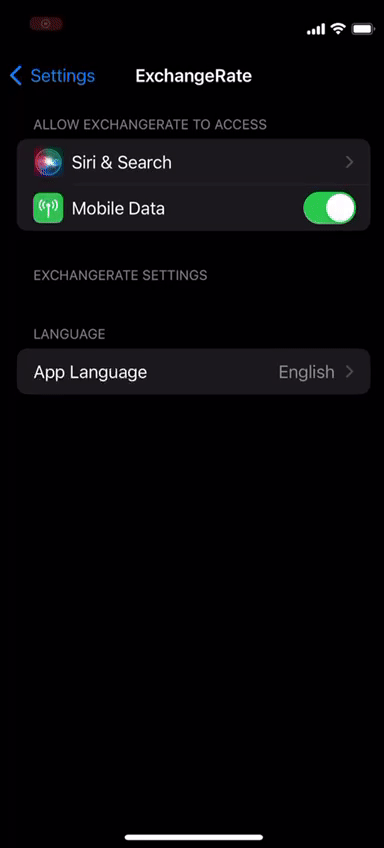

# SwiftUI-UIKit-Architecture <--> ExchangeRate

iOS app with hybrid architecture. It is based on SwiftUI with UIKit ViewController navigation. The base idea behind this is to show sell and buy rates of different kind of currencies. This is just a sample app to show the structure.

Other included dependencies:
  - R.swift
  - SwiftyMocky
  - SwiftLint
